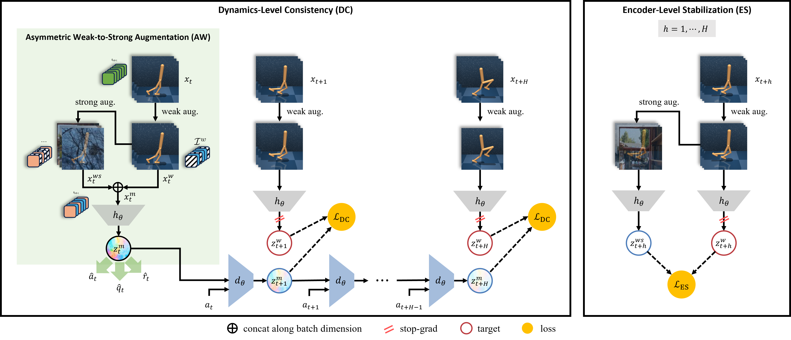

# TD-MPC2 + VIGOR

This repository adds VIGOR, a set of auxiliary objectives for zero-shot visual
generalization, to [TD-MPC2][tdmpc2]. Agents are trained on clean images and
evaluated without fine-tuning on unseen visual perturbations from a visual
generalization benchmark (VGB) built on the DeepMind Control Suite (DMC) and
robosuite. The same code trains and evaluates the unmodified TD-MPC2 agent as
a baseline. A DreamerV3-based variant of VIGOR ([DreamerV3+VIGOR][digor]) uses the same benchmark and
evaluation protocol. For more details, please visit [here][vigor-gen].



## Changes from TD-MPC2

This code is based on [nicklashansen/tdmpc2][tdmpc2]. The changes are:

- `vigor/algos/tdmpc2.py`, `vigor/common/`: the TD-MPC2 agent, restricted to
  single-task training from pixel observations.
- `vigor/algos/vigor.py`, `vigor/common/world_model.py`,
  `vigor/common/augmentation.py`: the VIGOR objectives. Weak (random shift)
  and strong (Places365 overlay) augmentations, a first-step latent that mixes
  weakly and strongly augmented samples, and a regularization loss that keeps
  strongly augmented latents close to weakly augmented ones.
- `vigor/train.py`, `vigor/evaluate.py`: training and the zero-shot
  generalization sweep for the algorithm selected with `name` (`TDMPC2` by
  default, or `VIGOR`; see `vigor/algos/__init__.py`).
- `vigor/envs/wrappers/`: benchmark wrappers for DMC (`DMCVGBWrapper`) and
  robosuite (`RoboVGBWrapper`), plus robosuite scene presets.
- `vigor/envs/dmcontrol.py`: DMC tasks rendered at 64x64 with 3 stacked frames
  and an action repeat of 2 (500 agent steps per episode). Training uses clean
  frames; evaluation renders through `DMCVGBWrapper`.
- `vigor/envs/robosuite.py`: a robosuite environment (Panda arms, `OSC_POSE`
  controller, 64x64 `agentview` camera, 500 control steps per episode, shaped
  reward), with the same frame stack and action repeat.
- `vigor/envs/data/`: background videos, colors, and textures for the
  benchmark.
- `vigor/config.yaml`: the algorithm choice (`name`), the VIGOR
  hyperparameters (`alpha`, `zeta`, `dataset_dir`, `places_*`), and the
  environment settings above.

## Installation

The code needs Linux x86_64, an NVIDIA GPU with CUDA 12, and Python 3.9.
MuJoCo renders headlessly through EGL (`MUJOCO_GL=egl` is set by default; set
the variable yourself to use another backend, e.g. `MUJOCO_GL=osmesa`).

Install the system libraries for EGL rendering, e.g. on Ubuntu:

```sh
sudo apt-get install -y libegl1 libgl1 libglew-dev libglfw3
```

Install with [uv][uv], which uses the pinned versions in `uv.lock`. This
downloads Python 3.9 if needed, installs PyTorch 2.5 with CUDA 12.4 wheels, and
installs this package in editable mode:

```sh
uv sync
source .venv/bin/activate
```

Then create the robosuite macros file once:

```sh
python $(python -c "import robosuite, os; print(os.path.dirname(robosuite.__file__))")/scripts/setup_macros.py
```

The code is built on robosuite v1.4; v1.5 changed its API and is not
supported.

VIGOR training also needs the [Places365][places] images (about 27 GB).
Evaluation and the TD-MPC2 baseline do not.

```sh
wget http://data.csail.mit.edu/places/places365/places365standard_easyformat.tar
tar -xf places365standard_easyformat.tar  # creates places365_standard/train/...
```

Set `dataset_dir` to the directory that contains `places365_standard/`, either
in `vigor/config.yaml` or on the command line.

## Training

| Suite | `task` |
|---|---|
| DMC | `walker-walk`, `walker-stand`, `cheetah-run`, `cartpole-swingup`, `reacher-easy`, `finger-spin` |
| robosuite | `Door`, `Lift`, `NutAssemblyRound`, `TwoArmPegInHole` |

Hyperparameters are managed with Hydra and overridden as `<name>=<value>`.
Train the TD-MPC2 baseline (the default algorithm, `name=TDMPC2`):

```sh
python vigor/train.py task=walker-walk seed=1 device=cuda:0
```

Train TD-MPC2+VIGOR by setting `name=VIGOR` and the Places365 directory:

```sh
python vigor/train.py name=VIGOR task=walker-walk seed=1 device=cuda:0 \
  dataset_dir=/path/to/dataset

python vigor/train.py name=VIGOR task=Door seed=1 device=cuda:0 \
  dataset_dir=/path/to/dataset
```

Runs are written to `logs/<name>/<task>/<seed>/<exp_name>/` (`exp_name`
defaults to `default`), and the final model to `models/final.pt` in that
directory.
Training logs to Weights & Biases by default; pass `enable_wandb=false` to log
only to the console and `eval.csv`. See [`vigor/config.yaml`](./vigor/config.yaml)
for all options.

### VIGOR hyperparameters (set with `<name>=<value>`):

| Name | Default | Description |
|---|---|---|
| `dataset_dir` | `/path/to/dataset` | Directory containing `places365_standard/train/`. Required for VIGOR training. |
| `alpha` | `1.0` | Weight of the regularization loss. |
| `zeta` | `1.0` | A fraction `1/(1+zeta)` of the first-step batch uses the strong view; the rest stays weak. |
| `places_num_bg` | `2048` | Number of Places365 images cached on the GPU, resized to the observation size. `0` streams the full dataset with random resized crops instead. |
| `places_num_workers` | `8` | Number of workers that load the Places365 images. |
| `places_seed` | `0` | Seed for choosing the cached images. The same seed and `places_num_bg` select the same images as the DreamerV3 variant. |

The weak view pads by 4 pixels before the random shift, and the strong view
blends a Places365 image over it with weight 0.5.

## Evaluation

Run the full sweep on a trained run, passing the same `name`, `task`, `seed`,
and `exp_name` as for training:

```sh
python vigor/evaluate.py name=VIGOR task=walker-walk seed=1 device=cuda:0
```

The script loads `logs/<name>/<task>/<seed>/<exp_name>/models/final.pt` and acts
with the deterministic planner. To evaluate a single condition, pass
`+gen_type` (and `+gen_diff` for DMC), for example
`+gen_type=cam_pos +gen_diff=hard`.

DMC conditions, each at `easy` and `hard` difficulty:

| `gen_type` | Perturbation |
|---|---|
| `original` | None (the training condition; evaluated once) |
| `background_color` | Random floor and sky colors |
| `background_video` | Natural videos behind the agent; `hard` also hides the floor |
| `cam_pos` | Offset camera position |
| `light_position` | Light moved to a random position on a sphere |
| `light_color` | Random light color |
| `moving_light` | Light that circles the scene during the episode |
| `objects_color` | Random agent color |

`cam_ori` (random camera orientation), `cam_dyn` (moving camera),
`normal_blur`, and `gaussian_noise` are also available as single conditions,
but are not part of the sweep.

robosuite bands, each with scenes 0 to 9:

| `gen_type` | Perturbation |
|---|---|
| `train` | Training-distribution scenes |
| `eval-easy` | Unseen textures, random colors and lighting |
| `eval-hard` | Unseen textures, random colors and lighting, a moving light, and a random robot color |
| `eval-extreme` | Unseen textures, random colors and lighting, a moving light, and video backgrounds |

Each condition is evaluated with 10 seeds, 25 to 34. Set the `EVAL_SEED_BASE`
environment variable to start from a different seed. On DMC, each seed runs
`eval_episodes` episodes (10 by default). On robosuite, each seed runs one
episode per scene, and success means the task is solved at the last step of the
episode. With `save_video=true` (the default), the first episode of the first
seed of each condition is saved to `videos/` in the run directory.

Results are written to the run directory as `eval_avg.csv` for the full sweep,
or `<gen_type>_<gen_diff>.csv` (DMC) / `<gen_type>.csv` (robosuite) for a
single condition. The script will not overwrite an existing results file.

| Suite | CSV columns |
|---|---|
| DMC | `exp_name`, `seed`, `episode_idx`, `episode_return` |
| robosuite | `exp_name`, `seed`, `episode_return`, `scene_id`, `success_rate` |

## License

This project is released under the MIT license (see `LICENSE`), which covers
both the TD-MPC2 code and the changes in this repository. The following parts
are adapted from other projects and remain under their original licenses:

- `vigor/envs/wrappers/dmcvgb.py` adapts code from [RL-ViGen][rlvigen]
  ([DMControl-GB][dmcgb]), including its copy of the
  [Distracting Control Suite][dcs] camera code. The DMC background videos in
  `vigor/envs/data/dmcvgb/video_easy` and `vigor/envs/data/dmcvgb/video_hard`
  come from DMControl-GB.
- `vigor/envs/wrappers/robovgb.py`, `vigor/envs/wrappers/custom_xml.py`, and
  `vigor/envs/wrappers/preset_customization.py` adapt the robosuite scene
  customization from [RL-ViGen][rlvigen] ([SECANT][secant]).
- [Places365][places] images are subject to the dataset's terms of use.

## Citation

If you use this code, please cite VIGOR and TD-MPC2:

```bibtex
@article{park2026vigor,
  title={VIGOR: Zero-Shot Visual Generalization via Latent-Space Consistency in Model-Based Reinforcement Learning},
  author={Park, Mingyu and Noh, Samyeul and Myung, Hyun and Lee, Donghwan},
  journal={arXiv preprint arXiv:2610.02801},
  year={2026}
}

@inproceedings{hansen2024tdmpc2,
  title={TD-MPC2: Scalable, Robust World Models for Continuous Control},
  author={Hansen, Nicklas and Su, Hao and Wang, Xiaolong},
  booktitle={International Conference on Learning Representations (ICLR)},
  year={2024}
}
```

## Acknowledgements

This code builds on [TD-MPC2][tdmpc2], [dm_control][dmc],
[robosuite][robosuite], [RL-ViGen][rlvigen], [DMControl-GB][dmcgb], the
[Distracting Control Suite][dcs], [SECANT][secant], and [Places365][places].

[tdmpc2]: https://github.com/nicklashansen/tdmpc2
[uv]: https://docs.astral.sh/uv/
[places]: http://places2.csail.mit.edu/
[dmc]: https://github.com/google-deepmind/dm_control
[robosuite]: https://github.com/ARISE-Initiative/robosuite
[rlvigen]: https://github.com/gemcollector/RL-ViGen
[dmcgb]: https://github.com/nicklashansen/dmcontrol-generalization-benchmark
[dcs]: https://github.com/google-research/google-research/tree/master/distracting_control
[secant]: https://github.com/LinxiFan/SECANT
[vigor-gen]: https://vigor-gen.github.io
[digor]: https://github.com/vigor-gen/dreamerv3_vigor.git